# Puja Vaahini — Pilot Contract and Specification Baseline

> **Status:** AGREED PILOT BASELINE (Free Pilot Agreed; Payment Changes Deferred)  
> **Document Version:** 1.2.0-pilot  
> **Last Updated:** 2026-11-05  
> **Target Pilot Service Area:** One Designated Metro Zone (e.g., Hyderabad Central / Cyberabad Pilot Area)  
> **Scope Confirmation:** Stakeholders agreed on a Free Pilot model. Payment gateway integration and minor currency unit conversion are deferred post-pilot. Focus is strictly on the core scheduling, dispatch, ritual fulfillment, and asymmetric completion verification loop.

---

## 1. Proposed Pilot Scope & System Boundary

### 1.1 In-Scope for Paid Pilot (Awaiting Owner Confirmation)
The paid-pilot is deliberately scoped to validate the core two-sided marketplace transaction loop between Devotees and Vedic Purohits with real financial commitments, high reliability, and data consistency:

1. **Client Applications:** 
   - **Devotee Android App** (Kotlin Multiplatform / Compose Multiplatform).
   - **Priest Android App** (Kotlin Multiplatform / Compose Multiplatform).
2. **Designated Geography:** Single contained service area (e.g., Hyderabad pilot bounding box, radius $\le$ 15 km) to keep transit predictable.
3. **Core Ritual Modality:** In-person home and venue Vedic pujas (e.g., *Gruhapravesam*, *Sri Satyanarayana Swamy Vratam*, *Maha Ganapathi Homa*).
4. **Scheduling Mechanism:** Calendar slot-based bookings with mutual time windows (explicit date + start/end time slots published by priests and locked by devotees).
5. **Free Pilot Model & Ritual Completion Verification:** In-person completion is verified via an asymmetric, secret devotee-held completion OTP submitted by the priest upon completion. Payment gateway integration is deferred.
6. **In-App Communication:** Two-way real-time in-app text chat between the assigned priest and devotee for address directions, sankalpam details, and arrival coordination.
7. **Sacred Materials (Samagri):** Itemized material checklist per pooja with explicit toggle for priest-supplied kit vs. devotee-arranged items.
8. **Notifications & System Alerts:** Transactional SMS / Push notifications for slot confirmation, priest arrival, cancellation, and payment receipts.
9. **Support & Operational Overrides:** Basic admin intervention capability for dispute resolution, slot unblocking, and manual refund execution.

### 1.2 Explicitly Deferred / Out-of-Scope (Requiring Explicit Scope Decisions)
The following legacy and secondary modules exist in the codebase but are **NOT** part of the minimal paid-pilot baseline unless explicitly requested and funded by the owner:
- **Payment Gateway Integration & Minor Currency Units:** Free pilot model agreed; payment gateway charges and paise conversion deferred post-pilot.
- **Instant Rapido-Style On-Demand Dispatch:** Dynamically ranking and pinging nearby moving priests with a 45-second timer. *Decision: Defer to post-pilot phase; pilot focuses on scheduled slots to protect ritual preparation quality.*
- **Local Puja Store Vendor App & Doorstep Delivery (Module B & H03):** Third-party vendor inventory and separate delivery stepper.
- **Temple CMS Portal & Sanctum VIP Ticketing / Ed25519 Offline Scanners (Module E):** Separate temple management and on-premise hardware scanning.
- **Two-Way WebRTC Video Broadcasting / E-Pooja Virtual Calls:** High-bandwidth streaming infrastructure.
- **Priest Colleague Referral / Sub-Delegation (Module D):** Automated cascading reassignment.

---

## 2. Baseline Architecture: Verified Behavior vs. Defects vs. Unverified

The following table records the current status of code inspected across the repository, linking findings directly to code evidence.

| Subsystem / Action | Status | Current Behavior | Defect / Risk | Evidence (File & Function) |
|---|---|---|---|---|
| **Authentication & Tokens** | **Verified** | Devotee & Priest login strictly via Phone + Bcrypt Password (cost 10); HS256 JWT tokens with session versions; single-use cryptographic email password reset links; authenticated in-app verified email management. | None. Auto-provisioning removed; phone normalization (+91 E.164) enforced; session revocation via `session_version` increment verified; verified email schema enforced in `000007_verified_email_support.sql`; older verification challenges superseded and existing email preserved until confirmed; legacy SMS code path hardened against bypass. | `backend/internal/auth/jwt.go`, `backend/internal/auth/email.go`, `backend/internal/db/recovery.go`, `backend/cmd/api-gateway/recovery_handlers.go` |
| **Catalog Query (`GetCatalog`)** | **Verified** | Fetches pooja packages from `pooja_catalog` and active custom services from `priest_custom_services` with 3-language fallback (`en`, `te`, `hi`). | Prices stored and returned as IEEE-754 `float64` rather than minor currency units. | `backend/internal/db/db.go:360` (`GetCatalog`), `backend/internal/models/entities.go:44` |
| **Priest Slots (`GetPriestSlots`)** | **Verified** | Queries `priest_availability_slots` by priest ID and date; checks Redis key `lock:slot:<id>` for held status. | In-memory mutex lock fallback is ignored when Redis is offline; dates/times parsed with ad-hoc formatting. | `backend/internal/db/slots.go:18` (`GetPriestSlots`), `backend/internal/db/slots.go:46` |
| **Slot Reservation (`HoldPriestSlot`)** | **Verified (Isolated)** | Acquires a 10-minute hold lock in Redis via `SetNX` or thread-safe `sync.Map` in-memory fallback. | **Critical Disconnect:** `CreateBooking` does not accept, validate, or release the slot hold lock! Held slots can be bypassed. | `backend/internal/db/slots.go:76` (`HoldPriestSlot`), `backend/internal/db/db.go:586` |
| **Booking Creation (`CreateBooking`)** | **Verified** | Requires valid devotee bearer token and active session version; verifies client-supplied `user_id` matches `claims.UserID`; copies samagri items, initializes chat room, generates 4-digit OTP returned only to creating devotee. | Arbitrary fallback users removed; slot binding deferred to Task 07; minor currency units deferred post-pilot. | `backend/internal/db/db.go:696` (`CreateBooking`), `backend/cmd/api-gateway/booking_handlers.go:46` |
| **Completion OTP Security** | **Verified** | 4-digit OTP generated during booking creation; completely removed from `BookingDetailResponse` via `json:"-"`; retrieved exclusively by booking owner via protected route `GET /api/v1/bookings/{id}/otp`. Assigned priest verifies OTP via `POST /api/v1/bookings/{id}/complete` without retrieval. | None. Error responses sanitized to `invalid completion OTP` without leaking expected secret. | `backend/internal/models/entities.go:150`, `backend/cmd/api-gateway/booking_handlers.go:210,309`, `backend/internal/db/db.go:947` |
| **Booking State Machine (`UpdateBookingStatus`)** | **Hardened (Task 05)** | Updates `bookings.status = $2`; verifies OTP on `COMPLETED`; enforces role ownership and assigned priest binding in DB mutation (`WHERE id = $1 AND priest_id = $3`). Devotees cannot set/change `priest_id`. Unassigned priests rejected with HTTP 403 Forbidden. | Transition sequence FSM (e.g. `REQUESTED` -> `ACCEPTED` -> etc.) scheduled for Task 06. | `backend/internal/db/db.go:823` (`UpdateBookingStatus`), `backend/cmd/api-gateway/booking_handlers.go:138` |
| **Bookings Query (`GetBookings`)** | **Verified** | Scoped strictly to authenticated caller's identity: devotees can only query their own bookings (`user_id = claims.UserID`); priests can only query their assigned bookings (`priest_id = claims.UserID`). Cross-account query overrides rejected with HTTP 403. | None. All booking lists omit `completion_otp` via `json:"-"`. | `backend/cmd/api-gateway/booking_handlers.go:90`, `backend/internal/db/db.go:748` |
| **In-App Chat Hub** | **Verified (Task 05 Protected)** | Authenticated WebSocket connection upgrade (`requireCallerSession`); room IDs verified against booking participant ownership (`VerifyBookingParticipant` / `VerifyChatRoomParticipant`); sender ID and role stamped from verified token claims. Client-supplied identities rejected. | Real-time push outside active WebSocket connection deferred to push notification task. | `backend/cmd/api-gateway/main.go:86` (`/ws/chat`), `backend/internal/db/chat.go` |
| **Cancellation & Refund Quote** | **Verified** | Computes cancellation quote with tiered fees (0% in requested, travel fee in transit) via cancellation rules engine. | Quotes and cancellation execution do not verify role authorization; refund execution is simulated in DB without payment gateway refund API calls. | `backend/internal/cancellation/rules.go:1`, `backend/cmd/api-gateway/main.go:1133` |
| **Android APK Compilation** | **Verified** | Devotee and Priest debug APKs assemble cleanly via Gradle daemon (`BUILD SUCCESSFUL in 38s`). | Contracts divergence between `common-contracts` and app network clients; hardcoded ngrok tunnel URL in network clients. | `apps/devotee-app/build.gradle.kts`, `apps/priest-app/build.gradle.kts`, `settings.gradle.kts` |
| **Payment Gateway Integration** | **Deferred (Free Pilot)** | Stakeholders agreed on a Free Pilot model. Payment gateway integration is deferred post-pilot. | None for pilot phase; ritual completion verified through secret devotee completion OTP. | Deferred per stakeholder agreement |
| **SMS / Push Notifications** | **Unverified** | Welcome message injected into DB chat table only. | No real SMS provider (Twilio, MSG91) or FCM push notification service wired. | `backend/internal/db/db.go:697` |

---

## 3. Canonical Contract: Current Behavior vs. Proposed Behavior

To establish a production-grade paid pilot, the protocol must transition from loosely-typed, unauthenticated prototypes to strict, canonical data structures.

| Dimension | CURRENT Behavior | PROPOSED Canonical Behavior (Pilot Contract) |
|---|---|---|
| **Account Identity & Auth** | Caller passes raw `user_id` or `priest_id` in JSON body or query param. If missing or invalid, DB silently picks last user or priest. | **Mandatory Authorization Header:** `Authorization: Bearer <JWT>`. Gateway validates token signature, extracts verified `account_id` and `role` (`devotee` \| `priest` \| `admin`). Callers cannot act on behalf of other accounts. |
| **Offering Identifiers** | Mix of `pooja_id` referencing `pooja_catalog` UUIDs or `priest_custom_services` UUIDs, with fallback defaults to row 1. | **Immutable Offering Reference:** `offering_id` (UUID) with strict type discriminator (`CATALOG_STANDARD` \| `PRIEST_CUSTOM`). If custom, priest ownership is strictly verified against the assigned priest. |
| **Slot Identifiers** | `CreateBooking` takes unparsed strings: `scheduled_date="Today"` and `slot_time="08:30 AM - 10:30 AM"`. Slot table is not linked. | **Strict Slot Foreign Key:** `slot_id` (UUID) referencing an active, held row in `priest_availability_slots`. Slot hold token (`hold_token`) must be supplied and verified during creation. |
| **Event Coordinates** | Unchecked `latitude`, `longitude` float values; fallback to `17.3850, 78.4867`. | **Validated Bounding Coordinates:** WGS-84 decimal coordinates validated against the active pilot geographic boundary (e.g. Hyderabad polygon / bounding box). |
| **Timestamps & Timezones** | Mixed local date strings (`"Today"`, `"2026-11-05"`) and naive server timestamps. | **UTC with Venue Timezone:** All storage and API timestamps transmitted as ISO 8601 UTC strings (`2026-11-05T03:30:00Z`). Payload includes explicit venue timezone (`Asia/Kolkata` / `+05:30`) and scheduled slot start/end UTC instants. |
| **Currency & Amounts** | IEEE-754 `float64` (`total_amount: 3716.0`) in Go models and `NUMERIC(10,2)` in Postgres. Vulnerable to rounding errors. | **Integer Minor Units:** All monetary amounts represented as 64-bit signed integers in currency minor units (e.g., `total_amount_minor: 371600` for INR 3,716.00). Currency code explicitly specified (e.g., `INR`). |
| **Booking State Model** | Free-form string updates; no validation of previous state; invalid states like `REJECTED` accepted. | **Strict Finite State Machine (FSM):** Enforced states: `REQUESTED` $\rightarrow$ `ACCEPTED` $\rightarrow$ `IN_TRANSIT` $\rightarrow$ `ARRIVED` $\rightarrow$ `POOJA_STARTED` $\rightarrow$ `COMPLETED` (or $\rightarrow$ `CANCELLED`). Illegal transitions rejected with HTTP 409 Conflict. |
| **Payment & Escrow State** | Conflated with booking state; hardcoded to `'HELD_IN_ESCROW'` on insert; released by simply overwriting string. | **Free Pilot (No Real Escrow):** Free pilot collects no money and holds no escrow; completion updates ritual state without financial release. Post-pilot: Separate payment lifecycle (`PAYMENT_PENDING` $\rightarrow$ `PAYMENT_AUTHORIZED` $\rightarrow$ `HELD_IN_ESCROW` $\rightarrow$ `RELEASED_TO_PRIEST`) once gateway integration is operational. |
| **Completion OTP** | Plaintext 4-digit numeric string exposed in all GET responses and booking details. | **Asymmetric OTP Visibility:** OTP is returned **ONLY** to the authenticated devotee upon booking confirmation. Redacted from priest views and public queries. Priest can only submit OTP for verification via `POST /api/v1/bookings/{id}/complete`. |
| **Idempotency** | No idempotency support. Repeated submissions duplicate bookings, charges, and slot bookings. | **Idempotency-Key Header:** `Idempotency-Key: <UUIDv4>` mandatory on all state-mutating POST/PUT endpoints. Cached in Redis / Postgres for 24 hours to guarantee exactly-once processing. |
| **API Error Format** | Inconsistent plain strings (`http.Error(w, "error", 400)`) or fragmented JSON. | **Standardized RFC 7807 Problem Details:**  <br>`{"type":"https://api.pujavaahini.com/errors/SLOT_HELD_EXPIRED", "title":"Slot Hold Expired", "status":409, "detail":"The 10-minute hold on slot has expired.", "instance":"/api/v1/bookings"}` |

---

## 4. Booking State Machine & Role-Based Transitions

The pilot booking lifecycle is strictly governed by the following role-based transition matrix. Any transition not explicitly listed is forbidden.

```mermaid
stateDiagram-v2
    [*] --> REQUESTED: Devotee submits booking & authorizes payment
    REQUESTED --> ACCEPTED: Assigned Priest accepts within expiry window
    REQUESTED --> CANCELLED: Devotee cancels OR Expiry timer lapses
    ACCEPTED --> IN_TRANSIT: Priest marks departure
    ACCEPTED --> CANCELLED: Devotee cancels (Free or grace tier) OR Priest cancels (Penalty)
    IN_TRANSIT --> ARRIVED: Priest reaches venue (geo-fence check)
    IN_TRANSIT --> CANCELLED: Devotee cancels (Travel allowance deducted)
    ARRIVED --> POOJA_STARTED: Priest begins ritual with devotee sankalpam
    POOJA_STARTED --> COMPLETED: Devotee shares OTP; Priest verifies OTP
    COMPLETED --> [*]
    CANCELLED --> [*]: Payment refunded per policy; Slot released
```



### 4.1 Transition Permissions Matrix

| From State | To State | Trigger / Action | Authorized Role | Preconditions & Side Effects |
|---|---|---|---|---|
| *None* | `REQUESTED` | `POST /api/v1/bookings` | `DEVOTEE` | Valid `slot_id` held by caller; valid `offering_id`; payment authorized; slot locked. |
| `REQUESTED` | `ACCEPTED` | `POST /api/v1/bookings/{id}/accept` | `ASSIGNED_PRIEST` | Must be executed before `accept_timeout` (e.g. 15 mins). Slot marked `is_booked = true`. |
| `REQUESTED` | `CANCELLED` | `POST /api/v1/bookings/{id}/cancel` | `DEVOTEE` \| `SYSTEM` | Full refund (`100%`); slot released; devotee or system expiry. |
| `ACCEPTED` | `IN_TRANSIT` | `POST /api/v1/bookings/{id}/in-transit` | `ASSIGNED_PRIEST` | Priest departs for venue. ETA broadcast to devotee app. |
| `ACCEPTED` | `CANCELLED` | `POST /api/v1/bookings/{id}/cancel` | `DEVOTEE` \| `ADMIN` | Subject to cancellation policy cutoff; slot released. |
| `IN_TRANSIT` | `ARRIVED` | `POST /api/v1/bookings/{id}/arrived` | `ASSIGNED_PRIEST` | Priest arrives at devotee address. Proximity check ($\le$ 300m). |
| `IN_TRANSIT` | `CANCELLED` | `POST /api/v1/bookings/{id}/cancel` | `DEVOTEE` \| `ADMIN` | Travel compensation fee credited to priest wallet; remainder refunded to devotee. |
| `ARRIVED` | `POOJA_STARTED` | `POST /api/v1/bookings/{id}/start` | `ASSIGNED_PRIEST` | Physical setup verified; sacred muhurtham initiated. |
| `POOJA_STARTED` | `COMPLETED` | `POST /api/v1/bookings/{id}/complete` | `ASSIGNED_PRIEST` | Priest submits 4-digit devotee OTP; backend verifies hash; status marked COMPLETED (in free pilot, real financial escrow is deferred; no money is released). |
| Any (pre-complete) | `CANCELLED` | `POST /api/v1/bookings/{id}/admin-cancel` | `ADMIN` | Emergency/support override with mandatory recorded audit reason. |

---

## 5. Route Inventory & Access Control

Every API route is categorized into one of four access tiers:

### 5.1 Public Routes (No Authentication Required)
- `GET /health` — Service liveliness and readiness probe.
- `POST /api/v1/auth/login` — Phone + OTP / Password authentication.
- `POST /api/v1/auth/recovery/start` — Initiates single-use cryptographic email password reset.
- `GET /api/v1/auth/recovery/reset` — Accessible HTTPS password reset form with strict anti-leakage headers.
- `POST /api/v1/auth/recovery/confirm` — Consumes reset token atomically and revokes active sessions.
- `GET /api/v1/auth/verify-email` — Verifies account email confirmation token.
- `POST /api/v1/auth/register-devotee` — Initial devotee onboarding with terms consent.
- `POST /api/v1/auth/register-priest` — Priest qualification registration with code of conduct consent.
- `GET /api/v1/poojas` — Public ritual catalog with localized titles, durations, and base prices.
- `GET /api/v1/panchangam/today` — Vedic astrological day calculation (Tithi, Nakshatra, Rahu Kalam).

### 5.2 Devotee Operations (Authenticated Devotee Only)
- `GET /api/v1/user/profile` — Retrieves caller's devotee profile, gotram, nakshatram.
- `POST /api/v1/priests/slots/hold` — Places a temporary 10-minute lock on a priest availability slot.
- `POST /api/v1/bookings` — Creates a booking with held slot, addresses, and authorized payment.
- `GET /api/v1/bookings` — Lists only the authenticated devotee's own bookings (`user_id = token.sub`).

### 5.3 Priest Operations (Authenticated Priest Only)
- `GET /api/v1/priests/slots` — Retrieves published slots for self.
- `POST /api/v1/priests/slots` — Publishes new availability windows.
- `GET /api/v1/priests/custom-services` — Manages custom pooja offerings and personalized dakshina.
- `POST /api/v1/priests/custom-services` — Creates a new priest-owned custom offering.
- `GET /api/v1/priests/me/bookings` — Lists bookings assigned to the authenticated priest.
- `POST /api/v1/bookings/{id}/accept` — Priest accepts assigned booking.
- `POST /api/v1/bookings/{id}/in-transit` — Priest marks journey started.
- `POST /api/v1/bookings/{id}/arrived` — Priest marks arrival at venue.
- `POST /api/v1/bookings/{id}/start` — Priest marks pooja started.
- `POST /api/v1/bookings/{id}/complete` — Priest submits devotee's 4-digit OTP to complete pooja and trigger escrow release.

### 5.4 Participant-Only Operations (Assigned Priest or Devotee for Booking ID)
- `GET /api/v1/bookings/{id}` — Retrieves booking details (OTP redacted for priest; visible for devotee).
- `GET /api/v1/bookings/{id}/materials` — Views itemized samagri checklist.
- `POST /api/v1/bookings/{id}/materials` — Updates custom materials checklist items.
- `GET /api/v1/bookings/{id}/cancel-quote` — Fetches dynamic cancellation fee and refund quote.
- `POST /api/v1/bookings/{id}/cancel` — Executes cancellation per policy.
- `POST /api/v1/chat/rooms` — Accesses the dedicated chat channel for the booking.
- `GET /api/v1/chat/messages` — Retrieves chat history.
- `POST /api/v1/chat/messages` — Posts message to booking chat thread.
- `WS /ws/chat` — Real-time bidirectional chat WebSocket (authenticated via query JWT or auth sub-protocol).

### 5.5 Admin Operations (Authenticated Admin Role Only)
- `GET /api/v1/dispatch/radar` — Operator map overview of active pilot services.
- `POST /api/v1/bookings/{id}/admin-cancel` — Support cancellation and refund force-override.
- `GET /api/v1/services/translations` — Multi-language catalog review.
- `PUT /api/v1/services/translations` — CMS translation updates.

---

## 6. Open Business Decisions (Awaiting Stakeholder Confirmation)

The following operational and commercial policies directly affect pilot economics and contract validation. **They must not be silently hardcoded.**

| Decision Item | Candidate Options | Impact on Architecture | Status |
|---|---|---|---|
| **Pilot Service Radius** | • Option A: 5 km (Hyper-local neighborhood)  <br>• Option B: 15 km (Central Metro area)  <br>• Option C: 30 km (Entire Urban Greater Area) | Determines geo-fence query bounds, travel feasibility, and nearby priest ranking filter. | **PENDING OWNER DECISION** |
| **Request Expiry Window** | • Option A: 15 minutes  <br>• Option B: 60 minutes  <br>• Option C: 4 hours (for scheduled next-day pujas) | Determines Redis key TTL and backend automated expiry worker cadence. | **PENDING OWNER DECISION** |
| **Priest Travel Buffer** | • Option A: 45 minutes between bookings  <br>• Option B: 60 minutes between bookings  <br>• Option C: Dynamic calculated buffer ($1.5 \times \text{ETA}$) | Determines slot creation collision rules and preventing double-booking overlapping transit. | **PENDING OWNER DECISION** |
| **Cancellation & No-Show Policy** | • Option A: 100% refund until 2 hrs before; Rs. 150 travel fee if in-transit; 0% if devotee no-show.  <br>• Option B: Flat 10% cancellation fee after priest acceptance. | Dictates logic in `internal/cancellation/rules.go` and payment gateway refund API calls. | **PENDING OWNER DECISION** |
| **Platform Commission** | • Option A: 0% introductory fee for pilot  <br>• Option B: 10% deducted from Dakshina fee  <br>• Option C: Fixed convenience fee (e.g., Rs. 99) charged to devotee | Determines ledger split calculations in escrow release worker. | **PENDING OWNER DECISION** |
| **Payout Timing & Gateway** | • Option A: Instant T+0 UPI transfer via RazorpayX / Cashfree Payouts upon OTP completion  <br>• Option B: Next-day (T+1) automated batch bank transfer | Dictates whether payout webhooks run synchronously on OTP submission or via batch daemon. | **PENDING OWNER DECISION** |
| **Payment Gateway Provider** | • Option A: Razorpay (Standard UPI, Cards, NetBanking)  <br>• Option B: Cashfree Payments  <br>• Option C: Sandbox/Mock Provider for internal testing | Dictates SDK integration, webhook verification secrets, and order authorization flow. | **PENDING OWNER DECISION** |

---

## 7. Pilot End-to-End Acceptance Journey

The target paid-pilot acceptance journey must pass end-to-end without artificial test mocks or unverified bypasses:

```mermaid
sequenceDiagram
    autonumber
    actor Devotee as Devotee (App)
    participant Gateway as API Gateway & Auth
    participant DB as Postgres & Redis
    actor Priest as Purohit (App)
    participant PG as Payment Gateway

    Note over Devotee, Priest: Phase 1: Discovery & Atomic Slot Hold
    Priest->>Gateway: POST /api/v1/priests/slots (Publish 09:00-11:30)
    Gateway->>DB: Store priest availability slot
    Devotee->>Gateway: GET /api/v1/poojas & GET /api/v1/priests/slots
    Gateway-->>Devotee: Catalog items + Green available slots
    Devotee->>Gateway: POST /api/v1/priests/slots/hold (slot_id, 10 min)
    Gateway->>DB: Redis SetNX lock:slot:<slot_id>
    Gateway-->>Devotee: 200 OK (Slot Held, expiry: T+10m)

    Note over Devotee, PG: Phase 2: Single-Submission Payment & Booking Creation
    Devotee->>PG: Authorize payment (Dakshina + Samagri in minor units)
    PG-->>Devotee: Payment Authorized (payment_id, signature)
    Devotee->>Gateway: POST /api/v1/bookings (Idempotency-Key, slot_id, payment_id)
    Gateway->>DB: Verify slot hold & payment signature
    Gateway->>DB: Insert booking (REQUESTED, HELD_IN_ESCROW)
    Gateway->>DB: Generate Completion OTP (visible to Devotee only)
    Gateway-->>Devotee: 201 Created (booking_id, Devotee OTP)

    Note over Priest, Gateway: Phase 3: Notification & Acceptance
    Gateway-)Priest: Push/Sync: Incoming Booking Request
    Priest->>Gateway: POST /api/v1/bookings/{id}/accept
    Gateway->>DB: Transition status: ACCEPTED; slot permanently booked
    Gateway-->>Priest: 200 OK (Booking Accepted)

    Note over Devotee, Priest: Phase 4: Crash Recovery & Transit
    Devotee->>Devotee: App process restart / kill
    Devotee->>Gateway: GET /api/v1/bookings (Fetch active)
    Gateway-->>Devotee: Active booking restored (ACCEPTED)
    Priest->>Gateway: POST /api/v1/bookings/{id}/in-transit
    Priest->>Gateway: POST /api/v1/bookings/{id}/arrived
    Priest->>Gateway: POST /api/v1/bookings/{id}/start

    Note over Devotee, Priest: Phase 5: Verification & Ritual Completion (Free Pilot)
    Priest->>Priest: Conducts Vedic pooja rituals at venue
    Devotee->>Priest: Verbally gives 4-digit Completion OTP
    Priest->>Gateway: POST /api/v1/bookings/{id}/complete (completion_otp)
    Gateway->>DB: Validate OTP matches hash
    Gateway->>DB: Transition: COMPLETED (Verified via Devotee OTP)

    Gateway-->>Priest: 200 OK (Booking completed successfully with verified OTP)
    Gateway-->>Devotee: 200 OK (Pooja Completed Receipt)
```

---
*End of Pilot Contract Document.*
