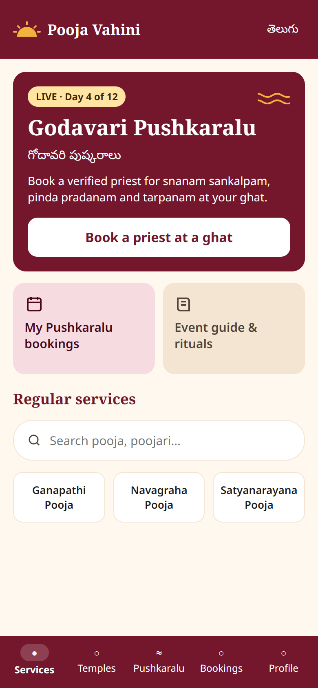
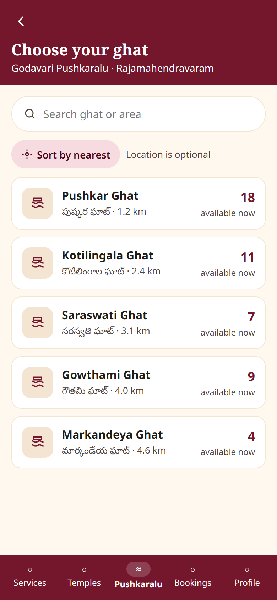
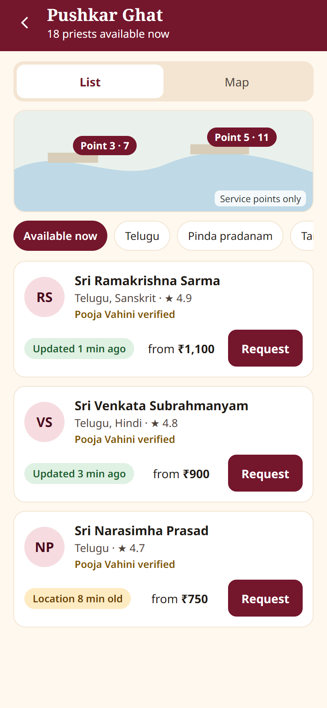
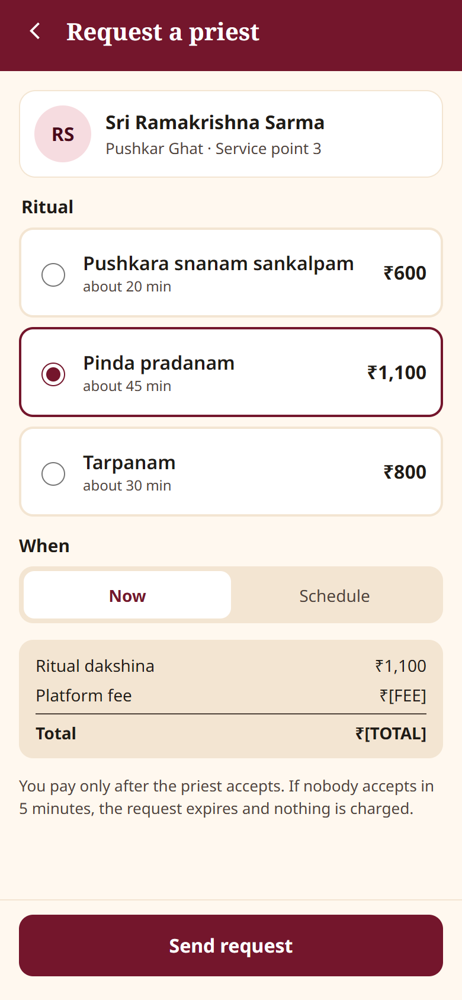
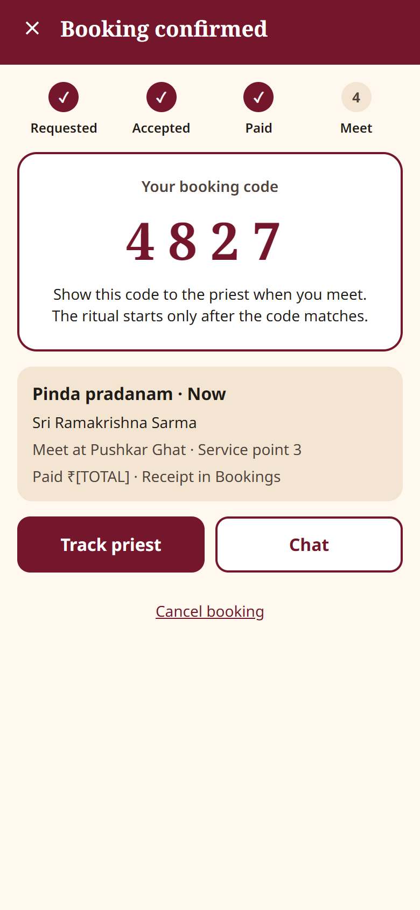
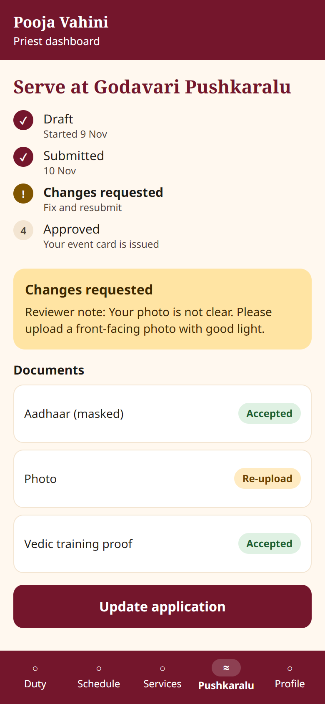
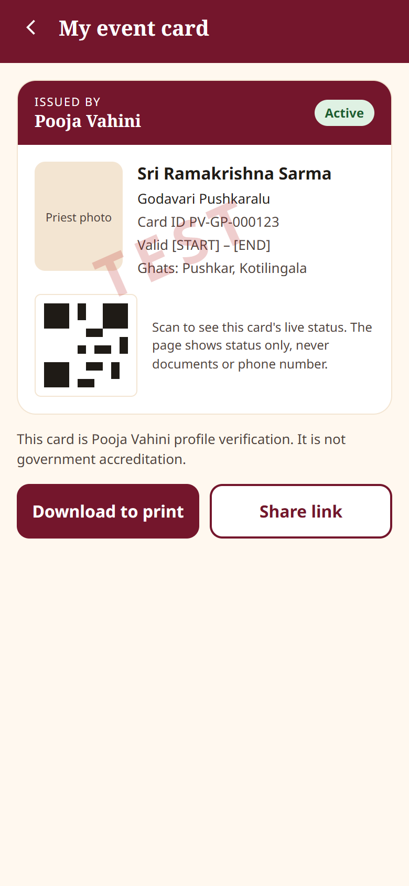
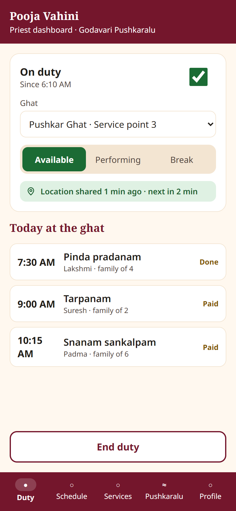

# Pushkaralu Event Mode: Screens and Build Plan

Status: Draft for review, 15 November 2026
Source of requirements: [pushkaralu-prd.md](pushkaralu-prd.md) (PRD v2)
Visual mockups: https://claude.ai/artifact/DrDkU6MNoZ5wLQ5BFXrRMQ (private canvas, 9 artboards)

Mockup images: [pushkaralu-mockups/](pushkaralu-mockups/), one PNG per screen per theme, named `<screen>-<royal|calm|earth>.png` (780 x 1688 px, phone at 2x). Each screen section below shows the Royal version.

This document is written for both people and AI coding agents. Every screen lists the enum entry, file to create, data it needs, states it must handle and the rules it enforces. Requirement IDs (EVT, PRI, ID, SRV, DUT, LOC, DEV, BKG, PAY, CMS, NTF) refer to PRD v2.

---

## 1. Ground rules

1. Pushkaralu is an event mode inside the existing apps. No new app, no navigation library.
2. Every Pushkaralu entry point is shown only when the server config says the event is `ACTIVE` and the relevant flag is on. The server also enforces every flag; the app hiding a button is never the only protection.
3. Turning a flag off never cancels or hides existing bookings. It only blocks new requests or card issuance.
4. Money is `Long` paise everywhere. Display with `formatMinorToRupees` from `common-contracts/.../money/MoneyFormatting.kt`.
5. Colours come only from `MaterialTheme.colorScheme` so all three appearances (ROYAL, CALM, EARTH in `Appearance.kt`) work. Headings use `MaterialTheme.typography` (serif headings from `appTypography()`).
6. All user-facing text goes through `LocalizationManager` string contracts (en, te, hi). Add a new `PushkaraluStrings` model; do not hardcode `when (language)` blocks.
7. Touch targets at least 48 dp. Text contrast at least 4.5:1.
8. Privacy: public map shows service points or approximate location only. Lock-screen notifications never show booking codes or precise location. QR page shows status only.

### Fixed status colours (not theme-dependent)

| Meaning | Background | Text |
| --- | --- | --- |
| Fresh / OK / Accepted | `#DFF1E3` | `#1B5E30` |
| Delayed / Needs action | `#FFEBC2` | `#6B4200` |
| Primary positive action (Accept, Available) | `#1B6B34` | `#FFFFFF` |

### Theme tokens used (from `Appearance.kt`)

| Token | ROYAL | CALM | EARTH |
| --- | --- | --- | --- |
| primary | `#74162C` | `#005451` | `#244D2A` |
| primaryContainer | `#F6DCE0` | `#C8EAE2` | `#D6EACD` |
| secondary | `#805500` | `#9A4900` | `#964421` |
| secondaryContainer | `#FFE4A3` | `#FFDCC0` | `#FFDBCC` |
| background / surface | `#FFF8EF` | `#F8FAF7` | `#FFF8ED` |
| surfaceVariant | `#F3E5D2` | `#DCEAE5` | `#F0E5D2` |
| onSurfaceVariant | `#50443B` | `#384B48` | `#4C493B` |

---

## 2. Navigation changes

### Devotee app (`apps/devotee-app/.../DevoteeApp.kt`)

Add to `enum class DevoteeScreen`: `PUSHKARALU_GHATS`, `PUSHKARALU_PRIESTS`, `PUSHKARALU_REQUEST`, `PUSHKARALU_BOOKING`.

Bottom bar: while `eventConfig.isActive`, the Store tab is replaced by a Pushkaralu tab that opens `PUSHKARALU_GHATS` (PRD v2 defers the Puja Store). When the event is not active, the bar is unchanged. Decision to confirm with owner.

State to add in `DevoteeAppRoot`: `eventConfig: EventConfig?`, `selectedGhatId: String?`, `selectedPriestId: String?`, `activeEventBookingId: String?`.

### Priest app (`apps/priest-app/.../PriestApp.kt`)

Add to `enum class PriestScreen`: `PUSHKARALU_APPLY`, `PUSHKARALU_CARD`.
Extend existing `DUTY_RADAR` (`DutyToggleScreen`) with an event section when the priest is approved for the active event.
Incoming request is a modal sheet over any screen, not an enum entry.

---

## 3. Devotee screens

### D1. Home with event banner



Other themes: [Calm](pushkaralu-mockups/D1-home-calm.png) · [Earth](pushkaralu-mockups/D1-home-earth.png)

- Where: top of `ui/catalog/PoojaCatalogScreen.kt` (no new file). New composable `ui/pushkaralu/EventBanner.kt`.
- Shows: badge "LIVE · Day X of Y", event name (English + Telugu), one-line description, primary button "Book a priest at a ghat", two tiles "My Pushkaralu bookings" and "Event guide & rituals". Regular catalog continues below.
- Data: `EventConfig` (name, nameTe, startsAt, endsAt, bookingEnabled).
- States: event active and booking on (full banner); event active, booking off (banner with text "New bookings are paused", no Book button, My bookings tile stays); event not active (no banner).
- Banner background `primary`, button white with `primary` text, badge `secondaryContainer`.
- Req: EVT-001..005, DEV-001.

### D2. Choose ghat



Other themes: [Calm](pushkaralu-mockups/D2-choose-ghat-calm.png) · [Earth](pushkaralu-mockups/D2-choose-ghat-earth.png)

- File: `ui/pushkaralu/GhatPickerScreen.kt`.
- Shows: header "Choose your ghat" + city; search field; chip "Sort by nearest" with note "Location is optional"; list of ghat cards (name, Telugu name, distance if GPS, count "available now").
- Data: `EventConfig.ghats` (from config) plus `GET /api/v1/events/{eventId}/ghats/availability` for counts.
- States: loading (reuse `VedicLoadingScreen`), offline (reuse `NoInternetScreen`), no GPS permission (list sorted by name, no distance), zero results for search.
- Req: DEV-001..002. Must work without GPS.

### D3. Priests at ghat



Other themes: [Calm](pushkaralu-mockups/D3-priests-at-ghat-calm.png) · [Earth](pushkaralu-mockups/D3-priests-at-ghat-earth.png)

- File: `ui/pushkaralu/GhatPriestsScreen.kt` (follow patterns in `ui/dispatch/RapidoNearbyPriestsScreen.kt`).
- Shows: header ghat name + available count; segmented List / Map; small map with service-point pins only; filter chips (Available now, language, ritual); priest cards (initials avatar, name, languages, rating, "Pooja Vahini verified", freshness chip, "from ₹X", Request button).
- Freshness chip: up to 5 min "Updated N min ago" (fresh colours); 5 to 15 min "Location N min old" (delayed colours); over 15 min the priest is excluded from Available now.
- Data: `GET /api/v1/events/{eventId}/ghats/{ghatId}/priests?available=true&lang=&ritual=`.
- States: loading, empty ("No priests available right now, try another ghat"), offline, booking disabled (Request buttons hidden).
- Polling: refresh with backoff (not fixed interval), stop when screen not visible.
- Req: DEV-003..004, LOC-004.

### D4. Booking request



Other themes: [Calm](pushkaralu-mockups/D4-booking-request-calm.png) · [Earth](pushkaralu-mockups/D4-booking-request-earth.png)

- File: `ui/pushkaralu/EventBookingRequestScreen.kt`.
- Shows: priest summary with meeting point; ritual radio list (name, duration, price); When segmented Now / Schedule (Schedule opens date-time picker within event dates); price breakdown (dakshina, platform fee, total); note "You pay only after the priest accepts. If nobody accepts in 5 minutes, the request expires and nothing is charged."; bottom button "Send request".
- After send: same screen switches to waiting state with countdown (5 min immediate, 2 h scheduled) and Cancel request button. On accept: payment step (gateway sheet), 15-minute payment window. On expiry: message and button back to D3.
- Data: priest services snapshot; `POST /api/v1/events/{eventId}/bookings` with `Idempotency-Key` header.
- Req: BKG-001..004, PAY-001, SRV-002 (show the frozen price the server returns, not a local calculation).
- If payments are cut from launch: skip payment step, booking confirms on accept, breakdown shows dakshina only.

### D5. Booking confirmed and booking code



Other themes: [Calm](pushkaralu-mockups/D5-booking-code-calm.png) · [Earth](pushkaralu-mockups/D5-booking-code-earth.png)

- File: `ui/pushkaralu/EventBookingScreen.kt`.
- Shows: four steps Requested, Accepted, Paid, Meet; large booking code card "Show this code to the priest when you meet. The ritual starts only after the code matches."; summary (ritual, priest, meeting point, amount paid); buttons Track priest (reuse `LiveTrackingScreen`) and Chat (reuse `ChatScreen`); Cancel booking link (reuse `SwiggyCancellationModal` with event policy).
- After completion: review prompt (rating + optional comment).
- Booking code is shown only inside the app, never in a push notification body.
- Req: BKG-005..007, NTF.

---

## 4. Priest screens

### P1. Event application



Other themes: [Calm](pushkaralu-mockups/P1-event-application-calm.png) · [Earth](pushkaralu-mockups/P1-event-application-earth.png)

- File: `ui/pushkaralu/EventApplicationScreen.kt`.
- Shows: title "Serve at <event name>"; vertical status steps; reviewer note card when status is Changes requested or Rejected; documents list each with state chip (Accepted, Re-upload, Pending); primary button whose label depends on status (Start application, Submit, Update application, View card).
- States: Not applied, Draft, Submitted, Changes requested, Approved, Rejected, Suspended. Reason text is mandatory and shown for every negative state.
- Documents upload to private storage via signed URL; never show full Aadhaar.
- Data: `GET/PUT /api/v1/events/{eventId}/participation/me`, `POST .../documents`.
- Req: PRI-001..003.

### P2. Event ID card



Other themes: [Calm](pushkaralu-mockups/P2-event-card-calm.png) · [Earth](pushkaralu-mockups/P2-event-card-earth.png)

- File: `ui/pushkaralu/EventCardScreen.kt`.
- Shows: card with header "ISSUED BY Pooja Vahini" and status chip; photo, name, event, card ID, validity, approved ghats; QR code pointing to the public status URL (opaque random ID); note "This card is Pooja Vahini profile verification. It is not government accreditation."; buttons Download to print (PDF) and Share link.
- Alpha builds show a diagonal "TEST" watermark.
- Government-issued card variant is hidden until `govtCardsEnabled` is true for that authority.
- States: Active, Suspended, Revoked, Expired, Replaced (card greyed with reason).
- Data: `GET /api/v1/events/{eventId}/credentials/me`.
- Req: ID-001..004.

### P3. Duty at ghat (extends existing duty tab)



Other themes: [Calm](pushkaralu-mockups/P3-duty-calm.png) · [Earth](pushkaralu-mockups/P3-duty-earth.png)

- File: extend `ui/duty/DutyToggleScreen.kt`; reuse `ui/duty/DutyOperation.kt` and `location/DutyServiceController`.
- Shows: On duty switch with start time; ghat / service point dropdown (only approved ghats); segmented Available / Performing / Break; location chip "Location shared N min ago · next in 2 min" (delayed colours when over 5 min, plus "Check location permission" action); list "Today at the ghat" (time, ritual, devotee first name and family size, state); End duty button.
- End duty with an active booking shows a warning dialog and keeps the booking.
- Location: Android foreground service with visible notification, one point every 2 minutes with capture time and accuracy, stops on End duty and on logout.
- Data: `POST /api/v1/events/{eventId}/duty/start|end`, `PUT .../duty/status`, `POST .../location` (batched points allowed).
- Req: DUT-001..002, LOC-001..005.

### P4. Incoming request sheet


Other themes: [Calm](pushkaralu-mockups/P4-incoming-request-calm.png) · [Earth](pushkaralu-mockups/P4-incoming-request-earth.png)

- File: `ui/pushkaralu/IncomingRequestSheet.kt`, shown as modal bottom sheet over any screen when a request push or in-app event arrives.
- Shows: badge "New request · Now/Scheduled"; countdown; ritual name; devotee first name and family size; meeting point; language; fee breakdown (dakshina, minus platform fee, you receive); note "After you accept, the devotee pays online. The booking is confirmed only when payment arrives."; buttons Decline and Accept.
- Accept calls the server, which rechecks availability in one transaction. If someone else already took the slot or the request expired, show "This request is no longer available".
- Data: `POST /api/v1/events/{eventId}/bookings/{id}/accept|decline` with `Idempotency-Key`.
- Req: BKG-002..003, PAY-001 (fee shown before acceptance).

---

## 5. CMS screens (temple-cms)

| Route | Purpose |
| --- | --- |
| `/events` | List events with status; create event |
| `/events/[id]` | Lifecycle status selector; switches Booking open, Card issuance, Government cards (locked until authority signs); affected active bookings count shown in confirm dialog before turning anything off; recent audit entries |
| `/events/[id]/ghats` | Add, edit, deactivate ghats and service points |
| `/events/[id]/participations` | Review queue: approve, request changes, reject (reason required), suspend |
| `/events/[id]/emergency` | One button that turns Booking open and Card issuance off without deleting data |

New shared component `temple-cms/components/Switch.tsx` (accessible `role="switch"` button). Pages call the backend through `lib/api.ts` `apiFetch`.

---

## 6. How the CMS toggle reaches the apps

1. CMS admin flips a switch on `/events/[id]` and confirms.
2. CMS calls `PUT /api/v1/admin/events/{id}` (admin role required).
3. Backend updates the `events` row, increments `config_version`, writes `audit_log`, and sends an FCM data-only message `{type: "event_config", version: "<n>"}` to all registered device tokens.
4. Apps fetch `GET /api/v1/events/config` (with ETag) at launch, on resume if the cached copy is older than 24 hours, and immediately on the `event_config` push.
5. Apps re-render: banners, tabs and Request / Accept buttons appear or disappear based on `status` and flags.
6. Server rejects new bookings or card issuance with HTTP 409 `event_booking_disabled` / `event_issuance_disabled` when the flag is off, so an app with stale config cannot bypass it. App shows "New bookings are paused".

### Shared contract (new file `apps/common-contracts/.../event/EventModels.kt`)

```kotlin
@Serializable
enum class EventStatus { DRAFT, SCHEDULED, ACTIVE, PAUSED, ENDED, ARCHIVED }

@Serializable
data class Ghat(
    val id: String,
    val name: String,
    val nameTe: String? = null,
    val lat: Double? = null,
    val lng: Double? = null,
    val active: Boolean = true
)

@Serializable
data class EventConfig(
    val eventId: String,
    val name: String,
    val nameTe: String? = null,
    val status: EventStatus,
    val bookingEnabled: Boolean,
    val cardIssuanceEnabled: Boolean,
    val govtCardsEnabled: Boolean = false,
    val startsAt: String,
    val endsAt: String,
    val ghats: List<Ghat> = emptyList(),
    val configVersion: Long
) {
    val isActive: Boolean get() = status == EventStatus.ACTIVE
}
```

`GET /api/v1/events/config` returns `{ "event": EventConfig | null }`. Null means no event mode.

---

## 7. Build order

Screens first with fake data, then backend, then wire up. Each step ends with something you can run.

1. **Contracts and strings.** Add `EventModels.kt` and `PushkaraluStrings` (en, te, hi). Extend `I18nCompletenessTest`.
2. **Devotee screens with fake config.** D1 to D5 using a hardcoded `EventConfig` and sample priests. Check all three themes and Telugu text.
3. **Priest screens with fake data.** P1 to P4 and the duty extension.
4. **Owner review** of the running screens on a real Android device.
5. **Backend config and toggle.** Migration `000017_events.sql` (events, ghats), `GET /api/v1/events/config`, `PUT /api/v1/admin/events/{id}`, data-only FCM support in `internal/notify/push.go`, audit row.
6. **CMS events page** with the switches and confirm dialog.
7. **Wire apps to real config.** Replace fake config with fetch at launch, resume and push. Verify toggle end to end: flip in CMS, apps update within seconds.
8. **Remaining backend per PRD v2:** participation and documents, credentials and QR page, priest services, duty and location ingest, discovery query, event bookings with accept transaction, payments and webhooks (if merchant account approved by 20 November).
9. **Launch gates** from PRD v2 section "Production readiness and launch gates".

---

## 7a. Implementation status (15 November 2026)

Built on real backend data (no fake data). Migrations `000017_events.sql` and `000018_event_participation_and_bookings.sql` must be applied before deploy.

| Area | Endpoint / file | Status |
| --- | --- | --- |
| Event config + CMS toggle | `GET /api/v1/events/config`, `/api/v1/admin/events*` | Built |
| Rituals (CMS) | `/api/v1/admin/events/{id}/rituals` | Built |
| Priest application + review | `/api/v1/events/{id}/participation/me`, `/api/v1/admin/events/{id}/participations/{priestId}` | Built (no document upload yet) |
| Priest prices | `PUT /api/v1/events/{id}/services/me` | Built, paise |
| Duty at ghat | `PUT/DELETE /api/v1/events/{id}/duty/me`, existing `/priests/me/location` every 2 min | Built |
| Discovery | `GET /api/v1/events/{id}/ghats/{ghatId}/priests`, `/ghats/availability` | Built, 15-min freshness, no coordinates exposed |
| Event booking | `POST /api/v1/events/{id}/bookings` (Idempotency-Key) | Built; price frozen in `agreement_snapshot` |
| Expiry | 5 min now / 2 h scheduled; sweeper every 30 s | Built |
| One ritual at a time | Accept rechecks inside the booking transaction | Built |
| Booking code | Required at POOJA_STARTED for event bookings | Built |
| Event card + public QR status | `GET /api/v1/cards/{code}` | Built (QR image not rendered in app yet; link shown) |
| Online payment | none | **Not built**: gateway not chosen; bookings are pay-at-ghat |
| Devotee screens | `ui/pushkaralu/EventScreens.kt`, `EventBookingScreens.kt` | D1 to D5 built (list view; no map widget) |
| Priest screens | `ui/pushkaralu/PriestEventScreen.kt`, booking code in `DutyToggleScreen` | P1 to P4 built (incoming request reuses the existing alert) |

## 8. Open items before or during build

- Confirm: Pushkaralu tab replaces Store while the event is live.
- PRD v2 open decisions 1 to 6 (river, ghats, peak numbers, gateway, fees and refund policy, verification documents, languages).
- Platform fee value (shown as `₹[FEE]` in mockups).
- Card validity dates and card ID format.
- Sample river, ghat names, priest names and prices in the mockups are placeholders, not real data.
